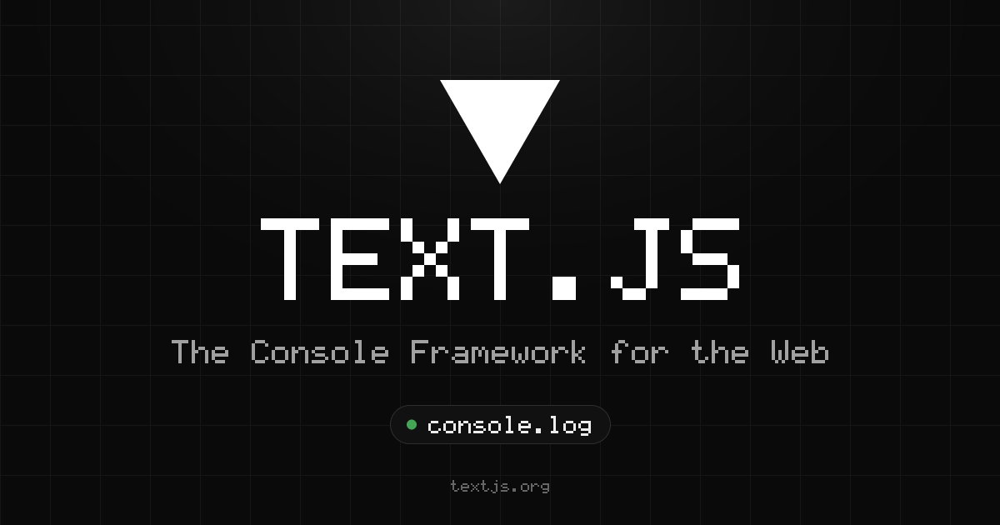

<div align="center">

# ▼ Text.js

Build full-stack React apps that render inside `console.log`.

[Docs](https://textjs.org/docs) · [Playground](https://textjs.org/playground) · [OpenCode](https://textjs.org/opencode)



</div>

## Quickstart

```bash
bunx create-text-app@latest
cd my-app && bun install && bun dev
```

Open [localhost:3000](http://localhost:3000) and press **⌘⌥J** (**Ctrl+Shift+J** on Windows and Linux).

## Example

```tsx
// app/page.tsx
import { useState } from "react";
import { Box, Text, useInput } from "@textjs/app";

export default function Page() {
  const [count, setCount] = useState(0);

  useInput((e) => {
    if (e.key === "up") setCount((c) => c + 1);
    if (e.key === "down") setCount((c) => c - 1);
  });

  return (
    <Box className="flex-col border rounded p-1">
      <Text bold>▼ Hello, console</Text>
      <Text color="muted">count = {count}</Text>
    </Box>
  );
}
```

Each frame is laid out with Yoga, run-length encoded into `%c` spans, and written in one `console.log`. Idle frames log nothing. See [`ARCHITECTURE.md`](ARCHITECTURE.md).

## Packages

| Package | Description |
| --- | --- |
| [`@textjs/app`](packages/app) | App Router, CLI and route handlers |
| [`@textjs/react`](packages/react) | Reconciler, components and hooks |
| [`@textjs/core`](packages/core) | Cell buffer, layout and the `%c` driver |
| [`@textjs/font`](packages/font) | FIGlet font parser and renderer |
| [`create-text-app`](packages/create-text-app) | Project generator |
| [`eslint-plugin-textjs`](packages/eslint-plugin-textjs) | ESLint rules for Text.js apps |
| [`@textjs/opencode`](packages/opencode) | Local bridge for textjs.org/opencode |

## OpenCode

A connected [OpenCode](https://opencode.ai) client in your console:

```bash
opencode service status     # If stopped: opencode service start
bun run dev:opencode        # From the repo root; no bridge needed
```

Then open [localhost:3001](http://localhost:3001) and press **⌘⌥J** (**Ctrl+Shift+J** on Windows and Linux). Without a server it falls back to a demo.

For the website’s `/opencode` page, run `bunx @textjs/opencode proxy` from any directory instead. Leave it running, enter `http://127.0.0.1:4096` in the server URL field, click **Connect**, and allow local network access if Chrome asks. The bridge handles CORS and server auth. See [Connecting](apps/opencode-console/README.md#connecting) for foreground servers and port conflicts.

## Development

```bash
bun install
bun test packages/ apps/opencode-console/ apps/web/
bun run typecheck
bun run build
```

`bun scripts/qa-starters.ts` scaffolds every create-text-app template from packed tarballs, installs it with bun and npm, and runs `text dev`, `build`, `start` and `run` against headless Chromium and a pty, along with `examples/` and the OpenCode and terminal apps. It fails on any console error or warning. It needs `bun install --cwd bench/devtools` once for Playwright; CI runs it in `.github/workflows/qa-starters.yml`.

## License

MIT
