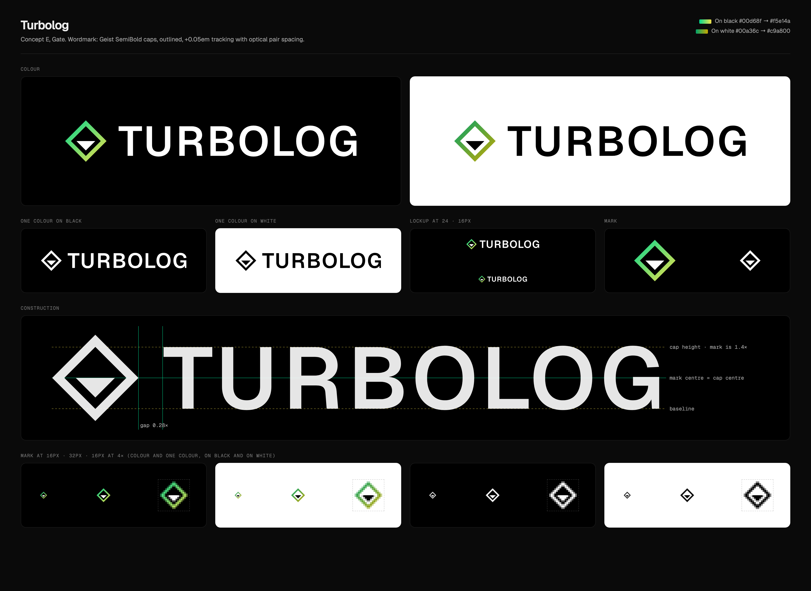
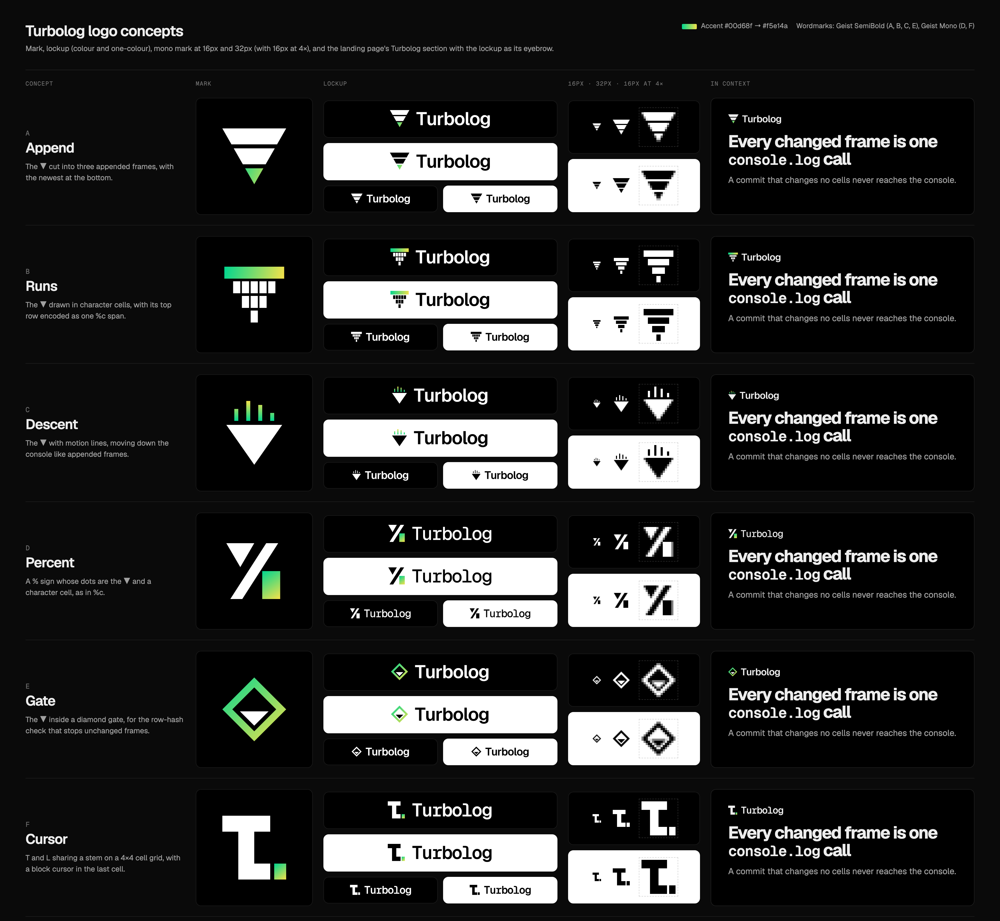

# Turbolog logo

Turbolog, the Text.js render engine, uses concept E (Gate): the ▼ inside a diamond gate, with "TURBOLOG" in Geist SemiBold caps. `final.png` shows the finished lockup and `concepts.png` shows the six concepts it was picked from.



## Final lockup

The files are in `final/`:

- `turbolog-lockup-{color,mono}-on-{black,white}.svg`: the mark and wordmark
- `turbolog-mark-{color,mono}-on-{black,white}.svg`: the mark alone
- `paths.json`: the path data that `TurbologLockup` in `apps/web/src/site/brand-marks.tsx` is built from

Construction:

- **Mark:** on a 32-unit grid. The ring's hollow has a half-width of 11.5. The ▼ runs parallel to the ring's lower edges, 3 units clear of them, with its top edge on the diamond's equator, so it lands on a whole pixel at 16px.
- **Wordmark:** "TURBOLOG" in Geist SemiBold caps, outlined. Tracking is +0.05em on top of Geist's kerning, with optical pair spacing (in 1/1000 em): TU −15, UR +5, RB +8, LO −30.
- **Lockup:** the mark is 1.4× the cap height and centred on the caps. The gap to the wordmark is 0.28× the mark's height.
- **Colour:** the ring carries the gradient, `#00d68f` → `#f5e14a` on black and `#00a36c` → `#c9a800` on white. The ▼ and the wordmark are one colour. The one-colour versions drop the gradient.

On the site, the lockup is 1em tall, so its caps match Geist caps at the same font size. The ▼ and the wordmark use `currentColor`, and the gradient switches with `color-scheme` through `light-dark()`. It appears once on each of these pages:

- the landing page's Turbolog section eyebrow (`apps/web/src/pages/home/Turbolog.tsx`)
- the header of `/docs/turbolog-engine` (`brand: "turbolog"` in `apps/web/src/docs/registry.ts`)
- the `/status` heading (`apps/web/src/pages/Status.tsx`)
- the header of the Turbolog blog post (`brand: turbolog` in its frontmatter)

## Concepts



| | Concept | Idea |
| :-- | :-- | :-- |
| A | Append | The ▼ cut into three appended frames, with the newest at the bottom. |
| B | Runs | The ▼ drawn in character cells, with its top row encoded as one `%c` span. At 16px and 32px every row is merged into a run. |
| C | Descent | The ▼ with motion lines, moving down the console like appended frames. |
| D | Percent | A % sign whose dots are the ▼ and a character cell, as in `%c`. |
| E | Gate | The ▼ inside a diamond gate, for the row-hash check that stops unchanged frames. |
| F | Cursor | T and L sharing a stem on a 4×4 cell grid, with a block cursor in the last cell. |

Each concept folder (`a-append/` to `f-cursor/`) contains:

- `mark.svg`: the mark in `currentColor`, with the accent gradient on one part
- `mark-mono.svg`: the mark in `currentColor` only
- `mark-small.svg`: hinted geometry for 16px and 32px (B only)
- `lockup.svg` and `lockup-mono.svg`: the mark with the wordmark

Marks are drawn on a 32-unit grid with edges on even units, so they land on whole pixels at 16px. The wordmark is outlined Geist SemiBold (A, B, C, E) or Geist Mono (D, F) with tight tracking, so the SVGs render without fonts installed. The accent gradient runs from `#00d68f` to `#f5e14a`, away from the blue-to-red of Turbopack and Turborepo. Every mark also works in one colour.

## Rebuilding

```sh
cd merch && bun install
bun brand/turbolog/build.ts
```

`build.ts` writes the concept and final SVGs, `final/paths.json`, `concepts.png` and `final.png`, using headless Chromium. It reuses the outlined-Geist helpers in `merch/scripts/lib.ts`. If the final geometry changes, copy the paths from `final/paths.json` into `TurbologLockup`.
