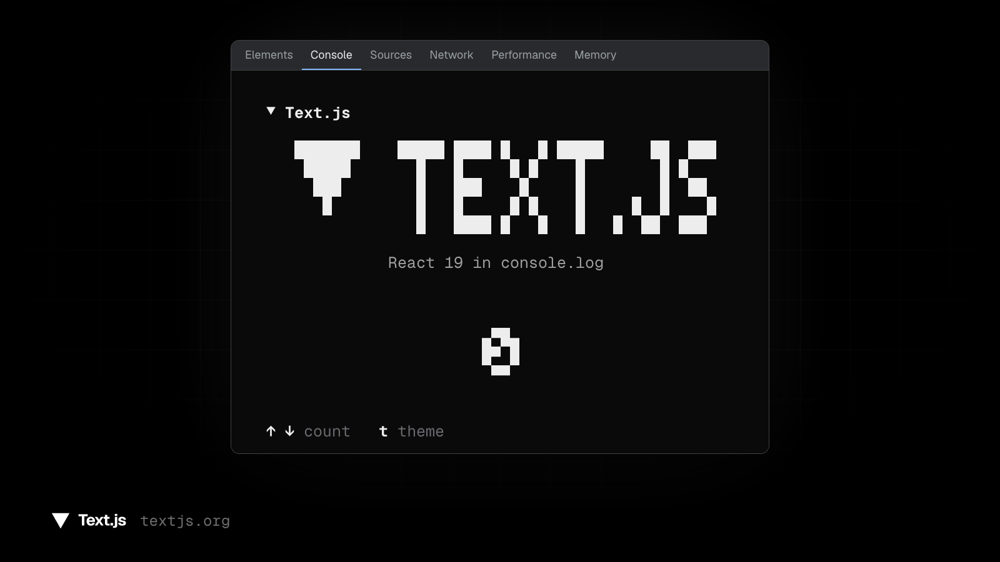

<!-- Built from README.md by apps/web/scripts/i18n/readme.ts. Edit README.md, then run `bun run i18n:translate` in apps/web. -->

<div align="center">

# ▼ Text.js

Text.js ब्राउज़र कंसोल में रेंडर होने वाले ऐप्स के लिए एक React फ़्रेमवर्क है।

[डॉक्स](https://textjs.org/hi/docs) · [सीखें](https://textjs.org/hi/learn) · [Playground](https://textjs.org/hi/playground) · [OpenCode](https://textjs.org/hi/opencode)



<!-- i18n:languages -->
[English](../../README.md) · [Bahasa Indonesia](README.id.md) · [Deutsch](README.de.md) · [Español](README.es.md) · [Français](README.fr.md) · [Italiano](README.it.md) · [Polski](README.pl.md) · [Português (Brasil)](README.pt-BR.md) · [Tiếng Việt](README.vi.md) · [Türkçe](README.tr.md) · [Русский](README.ru.md) · हिन्दी · [日本語](README.ja.md) · [한국어](README.ko.md) · [简体中文](README.zh-CN.md) · [繁體中文](README.zh-TW.md) · [<span dir="rtl">العربية</span>](README.ar.md) · [<span dir="rtl">עברית</span>](README.he.md) · [<span dir="rtl">فارسی</span>](README.fa.md) · [<span dir="rtl">اردو</span>](README.ur.md)
<!-- /i18n:languages -->

</div>

## शुरुआत

```bash
bunx create-text-app@latest
cd my-app && bun install && bun dev
```

[localhost:3000](http://localhost:3000) खोलें और [ब्राउज़र कंसोल खोलें](https://textjs.org/hi/docs/installation#open-the-console)। Text.js के लिए Bun 1.2+ या Node.js 22+ और डेस्कटॉप पर Chrome, Edge, Firefox या Safari चाहिए।

## उदाहरण

```tsx
// app/page.tsx
import { useState } from "react";
import { Box, Text, useInput } from "@textjs/app";

export default function Page() {
  const [count, setCount] = useState(0);

  useInput((e) => {
    if (e.key === "up") setCount((c) => c + 1);
    if (e.key === "down") setCount((c) => c - 1);
  });

  return (
    <Box className="flex-col border rounded p-1">
      <Text bold>▼ Hello, console</Text>
      <Text color="muted">count = {count}</Text>
    </Box>
  );
}
```

Yoga हर फ़्रेम का लेआउट बनाता है, Text.js उसे `%c` span में रन-लेंथ एन्कोड करता है और एक `console.log` कॉल में लिखता है। जिस फ़्रेम में कोई सेल नहीं बदला हो, वह कुछ लॉग नहीं करता। [`ARCHITECTURE.md`](../../ARCHITECTURE.md) फ़ाइल में रेंडरिंग पाइपलाइन की जानकारी है।

## पैकेज

| पैकेज | वर्शन | विवरण |
| --- | --- | --- |
| [`@textjs/app`](../../packages/app) | [](https://www.npmjs.com/package/@textjs/app) | App Router, `text` CLI और रूट हैंडलर |
| [`@textjs/react`](../../packages/react) | [](https://www.npmjs.com/package/@textjs/react) | रिकंसाइलर, कंपोनेंट और हुक |
| [`@textjs/core`](../../packages/core) | [](https://www.npmjs.com/package/@textjs/core) | सेल बफ़र, लेआउट और `%c` कंसोल ड्राइवर |
| [`@textjs/font`](../../packages/font) | [](https://www.npmjs.com/package/@textjs/font) | FIGlet फ़ॉन्ट पार्सर और रेंडरर |
| [`@textjs/opencode`](../../packages/opencode) | [](https://www.npmjs.com/package/@textjs/opencode) | textjs.org/opencode और OpenCode सर्वर के बीच लोकल ब्रिज |
| [`create-text-app`](../../packages/create-text-app) | [](https://www.npmjs.com/package/create-text-app) | प्रोजेक्ट जनरेटर |
| [`eslint-plugin-textjs`](../../packages/eslint-plugin-textjs) | [](https://www.npmjs.com/package/eslint-plugin-textjs) | Text.js ऐप्स के लिए ESLint नियम |

एडिटर और ब्राउज़र एक्सटेंशन भी यहीं हैं:

- [`packages/vscode-textjs`](../../packages/vscode-textjs): [VS Code एक्सटेंशन](https://textjs.org/hi/docs/vscode), जिसमें लाइव प्रीव्यू, App Router स्कैफ़ोल्डिंग और एरर कोड लिंक हैं
- [`packages/devtools-extension`](../../packages/devtools-extension): [Chrome DevTools एक्सटेंशन](https://textjs.org/hi/docs/devtools-extension), जिसमें कंपोनेंट ट्री, फ़्रेम इंस्पेक्टर और टाइमलाइन हैं

## डेवलपमेंट

```bash
bun install
bun test packages/
bun run typecheck
bun run --cwd apps/web dev
```

साइट [localhost:3000](http://localhost:3000) पर चलती है। [CONTRIBUTING.md](../../CONTRIBUTING.md) फ़ाइल में दूसरे ऐप्स, एंड-टू-एंड स्क्रिप्ट और रिलीज़ प्रक्रिया की जानकारी है।

## योगदान

बग रिपोर्ट और पुल रिक्वेस्ट का स्वागत है। पहले [CONTRIBUTING.md](../../CONTRIBUTING.md) फ़ाइल पढ़ें, और सुरक्षा से जुड़ी समस्याओं की रिपोर्ट [SECURITY.md](../../SECURITY.md) फ़ाइल में बताए तरीके से करें।

## लाइसेंस

[MIT](../../LICENSE)। साथ दी गई थर्ड-पार्टी फ़ाइलों के अपने लाइसेंस हैं: [`packages/font`](../../packages/font/NOTICE) में मौजूद FIGlet फ़ॉन्ट (BSD 3-Clause) और `apps/web` और `merch/fonts` फ़ोल्डर में मौजूद फ़ॉन्ट (SIL Open Font License 1.1)।
